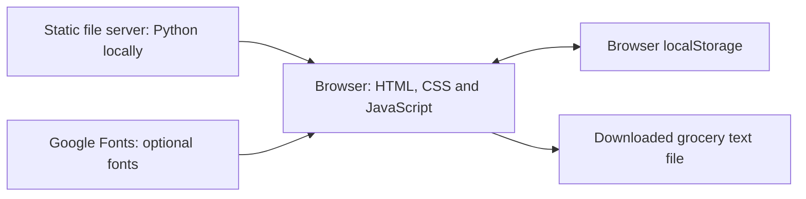
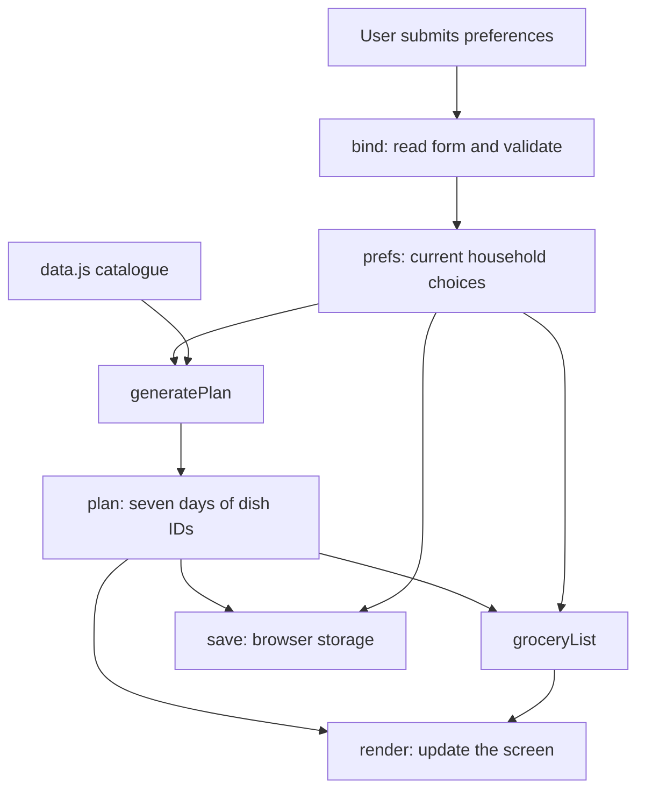
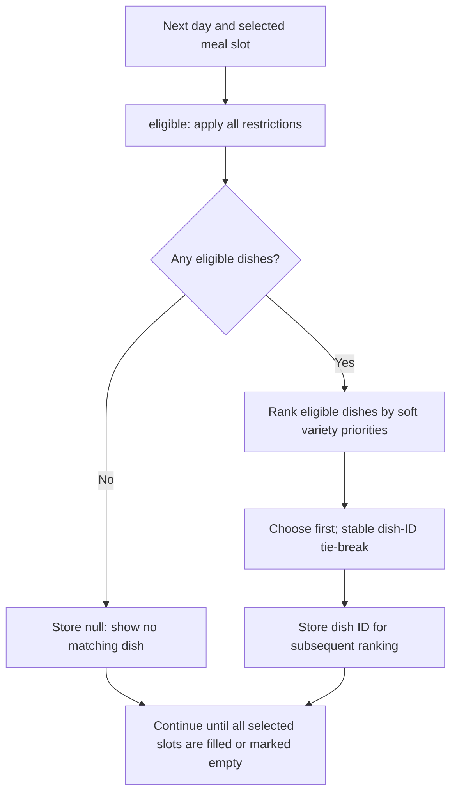
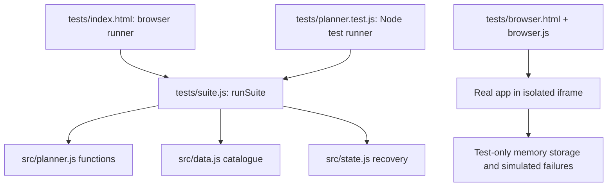

# GharKa Architecture

This document describes the existing MVP: an Indian household meal planner with seven-day menus, individual dish replacement, and grouped groceries. It explains current behaviour, not a proposed rebuild.

## 1. System architecture

GharKa runs in the user's browser. The browser displays the interface, chooses meals, calculates quantities, and saves the current household locally. Recommendations use a fixed catalogue and rules; there is no AI model, application backend, account system, or cloud database.

A **static server** delivers files without making meal-planning decisions. During local development, Python performs that job.



Preferences are not sent to a remote meal service. Fonts are the external resource referenced by the stylesheet; fallback fonts are available.

Start locally from the repository folder:

```sh
python3 -m http.server 5173 --bind 127.0.0.1
```

Open `http://127.0.0.1:5173`. No build or package installation is required. `npm start` runs the same command if npm is available. Opening the HTML file directly is not the supported startup method because the app uses JavaScript modules.

## 2. Application components

A **module** is a JavaScript file that shares selected data or functions with other files.

| Component | Responsibility |
|---|---|
| [index.html](../index.html) | Entry page; provides the empty `#app` container and loads scripts/styles. |
| [src/boot.js](../src/boot.js) | Shows a reloadable error banner for startup errors, uncaught action errors and rejected promises. |
| [src/app.js](../src/app.js) | Builds screens, handles user actions, manages browser state and saving. |
| [src/state.js](../src/state.js) | Validates and restores saved data, handles catalogue changes and reports storage failures. |
| [src/planner.js](../src/planner.js) | Filters dishes, generates weeks, selects replacements, and calculates groceries. It does not manipulate the webpage. |
| [src/data.js](../src/data.js) | Defines 46 dishes, 55 ingredients, cuisines, meal slots, and allergen labels. |
| [src/variety-data.js](../src/variety-data.js) | Explicit major-ingredient and family labels for all 46 dishes; independent of allergy aliases. |
| [src/styles.css](../src/styles.css) | Defines colours, fonts, layouts, focus styles, and adjustments for smaller screens. |
| [package.json](../package.json) | Defines optional start/test commands; declares no dependencies. |

In `app.js`, `render()` rebuilds the application inside `#app`. It selects `planView()`, `preferencesView()`, or `groceryView()`. Then `bind()` reconnects the controls to their actions. `openDish()` displays ingredients and brief cooking notes; `toast()` displays temporary feedback.

Navigation switches the `view` variable within the same page. There is no URL-based screen router.

### Catalogue and plan data

`data.js` converts compact recipe rows into dish objects with `id`, `name`, `slots`, `cuisine`, `time`, `emoji`, `ingredients`, `method`, `diet`, `allergens`, and `variety` fields. The latter contains `majorIngredients` and `families` arrays from an explicit dish-ID mapping; no quantities are inferred.

Every recipe explicitly lists its own ingredients and seasonings; there is no automatic shared seasoning bundle. Ingredient quantities are approximate amounts for **one adult serving**. A separate ingredient record supplies its name, category, unit, and allergen tags. Lunch and dinner share the same eligible meal-slot catalogue.

A day stores dish IDs, rather than full copies of recipes. For example:

```js
{
  day: 'Monday',
  meals: {
    Breakfast: 'kanda-poha',
    Lunch: 'rajma',
    Snacks: 'fruit',
    Dinner: 'khichdi'
  }
}
```

`dishById()` resolves an ID into the corresponding recipe. A `null` value means no dish matched that slot. Unselected slots are omitted.

## 3. Startup and data flow

On startup, `index.html` loads `boot.js` and the main module, `app.js`. That module imports the catalogue and planner functions, uses `state.js` to restore saved data. First-time visitors receive a default plan. Invalid menus are rebuilt with valid saved restrictions; unreadable preferences require confirmation and show no suggested dishes. It saves safe state and calls `render()`.

Defaults are vegetarian, four people, all four meal slots, all cuisines, no exclusions, and a 45-minute limit per meal.



The form handler inside `bind()` requires at least one selected slot and calls `validPreferences()`. Successful submission generates a new week and clears grocery checkmarks. Unsaved form edits do not change stored preferences.

Even changing only household size through this form generates a new week. Household size itself does not influence dish eligibility; it influences quantities.

## 4. Meal planning flow

The main functions are in [src/planner.js](../src/planner.js).

### Filter first

`eligible(preferences, slot)` keeps dishes that satisfy all applicable rules:

- Correct meal slot and cooking time within the chosen limit.
- Allowed diet: vegetarian permits vegetarian dishes; eggetarian also permits eggs; non-vegetarian permits all three classifications.
- Selected regional cuisine, or `Everyday Indian`. Selecting no cuisines allows all regions.
- No allergen tag matching a selected allergy.
- No recognised excluded ingredient, allergen, or exact dish name.

`exclusionTerms()` normalises and separates input. `resolveExclusions()` resolves recognised ingredient names, common plurals, aliases such as `aloo`, allergen labels, and exact dish names into identities. It does not search words inside descriptive labels such as “non-peanut”. Unknown terms block new preference saves with a clarification message; the planner returns no suggestions if unresolved restrictions reach it, including from saved data. Matching is a limited dictionary lookup, not natural-language understanding. Explicit `ingredientAliasGroups` link chickpea/chana/besan names and supported flour names to both `chana` and `besan`, conservatively in both free-text fields. Separate exact groups cover mung/green gram, arhar/pigeon pea, red lentil, kidney bean, urad/black gram in batter, and suji/sooji. Bare “gram”, “dal” and “flour” remain unknown; exact dish exclusions retain their existing meaning.

### Build a week

`generatePlan()` visits Monday through Sunday. Inside a day it fills the smallest eligible pools first (canonical meal order breaks equal pool sizes), while preserving the selected slot order for display. `rankCandidates()` compares candidates against already planned meals, excluding the target slot.



All four slots produce 28 meal positions; dinner alone produces seven. Days are labels, not dated calendar entries. Planning context resets for every new week, so there is no memory of earlier weeks. Limited eligible choices can repeat. Restrictions are not deliberately relaxed to fill empty positions.

### Replace one dish

`replacement()` reapplies eligibility, excludes the current dish, and calls the same `rankCandidates()` against the rest of the week, including both adjacent days. It returns the best eligible alternative even when repetition is unavoidable. With no alternative, it returns `null` and the interface keeps the existing meal.

Ranking compares these values in order, with lower values preferred: same-day exact-dish occurrences; same-day major-tag overlaps; weekly dish occurrences; adjacent-day meals sharing an ID or family; total weekly major-tag plus family-tag overlaps. Dish ID breaks a complete tie using stable string ordering. Each priority wins over every later priority; candidates are never removed by variety. Multiple major ingredients and families are supported. There is no base balancing or weighted optimisation.

Metadata labels describe culinary roles. Thepla's minor besan does not count as chickpea-major, but remains fully subject to exclusions. Onion defines kanda poha and tomato defines rasam/sandwich; routine seasonings elsewhere do not drive variety. Existing ingredient quantities, allergens and saved-plan validity are unchanged, so no catalogue-version bump is needed.

Selection is deterministic: unchanged preferences produce the same regenerated week. Old optional random callbacks supplied by legacy tests/storage code no longer influence selection. A day-by-day greedy ranking does not promise the globally best week; limited pools and higher priorities can cause repeats or adjacent similar families.

The replacement click handler in `bind()` changes only the selected slot, clears all grocery checkmarks, saves, and redraws. A replacement does not teach the app a new permanent dislike.

## 5. Grocery generation flow

`groceryList(plan, people)` reads all scheduled dishes, skips empty slots, and combines amounts by ingredient ID.


For two rice dishes that each require 75 g per adult, a household of four needs:

```text
(75 g × 4) + (75 g × 4) = 600 g rice
```

Totals are rounded to three decimal places after aggregation. `formatAmount()` formats display quantities and converts large gram/millilitre amounts to kilograms/litres, for example `1500 g` to `1.5 kg`.

`groceryView()` groups the items using categories from `data.js`. `openDish()` separately scales recipe details for the household. The download handler inside `bind()` creates `gharka-grocery-list.txt` directly in the browser, including checkmarks.

The grocery list is derived from the plan each time it is rendered; it is not separately saved. There is no pantry subtraction, pack-size rounding, child-serving adjustment, or price calculation.

## 6. Persistence and storage

**State** means the app's current information. `app.js` keeps `prefs`, `plan`, and `checked` in memory while the page is open. `checked` contains purchased ingredient IDs.

`app.js` calls `saveState()` in `state.js` to serialise the current state under the localStorage key `gharka-v1`:

```js
{ version: 1, catalogueVersion: 2, prefs, plan, checked }
```

Saving happens at startup and after plan, preference, or checklist changes, except while unreadable preferences await confirmation. Navigation and temporary messages are not saved.

On refresh, `loadState()` reads the record; `restoreState()` and `validPlan()` check preference enums, day order, exact selected slots and dish eligibility. A valid plan is restored without reshuffling. An invalid menu is regenerated under valid saved restrictions with checkmarks cleared. Corrupt or rejected preferences produce an empty plan until the user reviews and saves their choices. Unknown exclusions continue to block suggestions.

A catalogue-version change keeps valid meal IDs but clears shopping ticks because quantities may have changed. Otherwise, checked IDs are deduplicated and limited to the current grocery list. Failed reads require preference confirmation; failed writes leave the current screen usable and offer **Try saving again**. Refresh can lose unsaved changes.

Important boundaries:

- Storage belongs to that browser profile and origin: protocol, host, and port. `localhost:5173` and `127.0.0.1:5173` do not share it.
- There is one household and one current plan per stored record; no account, sync, backup, or history.
- Refresh returns to the weekly-plan screen and discards unsaved form edits.
- Clearing site data removes saved information. Storage access or writes can fail.
- Recipe contents are not saved with the plan. Catalogue edits can change quantities for previously saved dish IDs.
- Record and catalogue versions support the current format and recipe update. There is no general migration engine or recovery of historical records.

## 7. Testing architecture

The same logic checks run through two entry points:



With the server running, open `http://127.0.0.1:5173/tests/`. Alternatively, use `npm test` when Node/npm are installed. The Node adapter uses built-in `node:test` and `node:assert/strict`; no test package is required.

The 68 shared checks cover filters and dietary regressions, generation across 150 constructed household configurations, swaps, explicit recipe ingredients, grocery arithmetic, household scaling, display precision, empty plans, preference validation, saved-state restoration, catalogue updates and failed storage. Variety regressions cover explicit metadata, ordered preferences, deterministic selection, hard-constraint fallback, swaps, groceries and preservation of safe saved plans.

Open `/tests/browser.html` and select **Run browser checks** for 18 additional automated checks. The runner loads the actual application into an iframe and substitutes in-memory storage, protecting the user's saved household. It exercises swaps, checklist updates, reload, dialogs, invalid forms, empty states, corrupt records, blocked/quota storage, download content/failure, runtime-error feedback and layouts at 320, 375, 390, 768 and 1200 pixels.

Download checks intercept the browser API to verify the generated file content; they do not prove that every operating system saves the file correctly. Viewport checks do not replace real-phone or screen-reader testing. Tests do not establish recipe accuracy, nutritional balance or comprehensive allergy safety. See [TESTING.md](TESTING.md) for evidence and remaining checks.

## 8. Why HTML, CSS, and JavaScript were sufficient

This MVP has three screens, a small built-in catalogue, and calculations that can run immediately in the browser. Native HTML supplies forms and dialogs; CSS supplies responsive layouts; JavaScript supplies selection rules, event handling, storage, and downloads.

Keeping the stack small avoids build configuration, dependency maintenance, paid services, and account setup. The beginner owner can run it with one command. Separating the catalogue, planner, and UI already provides useful boundaries without a framework.

The tradeoff is that `app.js` builds large HTML strings and redraws the whole interface. As interactions grow, maintaining state and focus this way becomes harder. A framework would not, by itself, improve recipe data or recommendation correctness.

## 9. When to consider React, a backend, or a database

These are separate decisions, not one mandatory upgrade.

| Addition | Conditions that would justify it | What would change |
|---|---|---|
| React | Many reusable interactive components, complex editing flows, several coordinated screens, or repeated UI-state/focus bugs. | Replace screen rendering and event wiring incrementally. Keep and test the independent planner functions. React does not require a backend. |
| Backend | Accounts, shared households, protected external-service credentials, permissions, or operations that must be controlled centrally. | Add a server API, authentication where needed, server-side validation, and operational monitoring. |
| Database | Durable cross-device preferences, multiple saved weeks, shared shopping progress, or centrally edited recipe content. | Store versioned users/households, plans, and recipes with appropriate access controls and backups, normally behind an API. |

Making the site publicly accessible alone does not require React or a database: static hosting can serve the existing files. A public pilot still needs corrected content, broader testing, HTTPS hosting, and a reliable release process.

Before any major architecture change, explain the user problem, simpler alternatives, tradeoffs, and data migration impact. Preserve existing functionality and avoid dependencies without a demonstrated need, as required by [AGENTS.md](../AGENTS.md).

## 10. Current implementation caveats

These are existing limitations, not changes made by this document:

- Recipe-specific ingredient lists replace the old common seasoning shortcut. Portions and cooking notes still need review by experienced home cooks.
- Free-text vocabulary is limited. Unknown terms now block planning until clarified, rather than being silently ignored. Recognised ingredient identities fix the earlier groundnut/non-peanut-oil false match and ordinary plural exclusions.
- Diet classification currently recognises the ingredient keys `chicken`, `fish`, and `egg`. Adding another meat requires updating that classification logic.
- Allergen enforcement depends on the catalogue being complete and accurate. Packaged-food contents and cooking cross-contact are outside the app's knowledge.
- Portions assume adults, cooking times assume some advance preparation, and no nutrition or budget optimisation exists.

Content correctness and missing tests should be addressed before adding architectural complexity. The product scope remains documented in [MVP.md](MVP.md).
